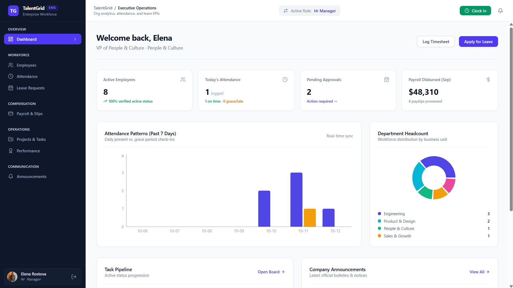

# TalentGrid — Employee Management System

A modern Employee Management System (EMS) designed to simplify employee administration, attendance tracking, leave management, payroll, and workforce operations.

🌐 **Live Demo:** [Open TalentGrid EMS](https://ais-dev-nbj6etcc4xr6cyqu22wph2-665529278416.asia-east1.run.app)

## 📸 Dashboard Preview



## ✨ Key Features

- **Employee Management:** Manage employee profiles and employment details.
- **Dashboard & Analytics:** View employee statistics, attendance patterns, department headcount, and pending approvals.
- **Attendance Management:** Track employee check-ins, check-outs, and attendance records.
- **Leave Management:** Submit and manage employee leave requests.
- **Payroll Management:** Organize salary records and payslip information.
- **Projects & Tasks:** Manage tasks, deadlines, and project progress.
- **Performance Management:** Organize employee goals and performance reviews.
- **Announcements:** Display company updates and important notices.
- **Role-Based Access:** Support different access levels for HR managers, administrators, managers, and employees.
- **Responsive UI:** Clean dashboard interface with charts and organized navigation.

## 🛠️ Technology Stack

Update this section to match the technologies actually used in the project.

- Frontend: React.js
- Styling: Tailwind CSS
- Backend: Node.js and Express.js
- Database: MongoDB
- Authentication: JWT, if configured
- Charts: Recharts
- Version Control: Git and GitHub

## 🖥️ Dashboard

The dashboard provides an overview of workforce operations, including:

- Active employees
- Today's attendance
- Pending approvals
- Payroll summary
- Attendance patterns
- Department headcount
- Task pipeline
- Company announcements

## 🚀 Getting Started

### Prerequisites

- Node.js and npm
- Git
- MongoDB, if required by the application

### Installation

Clone the repository:

```bash
git clone YOUR_GITHUB_REPOSITORY_URL
cd employee-management-system
```

Install dependencies in the directories used by your project:

```bash
npm install
```

Configure the required environment variables using your project's `.env.example` file, then start the application using the scripts defined in `package.json`.

## 🔒 Security

- Protect sensitive employee information.
- Enforce authorization on protected backend routes.
- Store passwords securely.
- Keep API keys, database credentials, and deployment tokens out of GitHub.
- Use environment variables for secrets.

## 🚀 Live Deployment

Access the deployed application:

**[TalentGrid — Employee Management System](https://ais-dev-nbj6etcc4xr6cyqu22wph2-665529278416.asia-east1.run.app)**

## 🗺️ Future Enhancements

- Employee account creation and invitation workflow
- Password reset and account activation
- Advanced attendance reports
- Automated leave approval workflows
- Payroll exports and downloadable payslips
- Real-time notifications
- Automated testing and CI/CD

## 👨‍💻 Author

**Ujjwal Awasthi**

GitHub: https://github.com/ujjwalawasthi7597-del

---

⭐ If you find this project useful, consider giving the repository a star.
